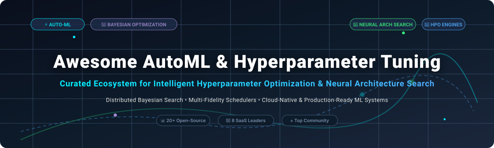

# ⚡ Awesome AutoML &amp; Hyperparameter Tuning 🚀

> 🎯 A curated directory of top **Automated Machine Learning (AutoML)** platforms, **Hyperparameter Optimization (HPO)** frameworks, **Neural Architecture Search (NAS)** engines, and distributed Bayesian optimization tools.

---

## 📑 Table of Contents

- [📊 Sector Overview & Market Dynamics](#-sector-overview--market-dynamics)
- [🏢 SaaS & Hosted Platforms](#-saas--hosted-platforms)
- [💻 Open-Source GitHub Projects](#-open-source-github-projects)
- [🤝 How to Contribute](#-how-to-contribute)
- [☕ Support](#-support)
- [⭐ Star History](#-star-history)
- [⚠️ Disclaimer](#-disclaimer)

---

## 📊 Sector Overview & Market Dynamics

The global **Automated Machine Learning (AutoML) & Hyperparameter Tuning** market is estimated at **$2.34B – $4.5B** in 2025 and is projected to reach **$3.43B – $6.5B+** by 2026, compounding at an accelerated **45%–48% CAGR**.

Market dynamics exhibit **moderate fragmentation with multi-cloud polarization**:
- 🌐 **Hyperscalers (Google Cloud, AWS, Microsoft Azure)** dominate turnkey enterprise pipeline hosting with integrated, consumption-billed black-box optimizers (Vizier, SageMaker Autopilot).
- 🛡️ **Specialized Enterprise Platforms (DataRobot, H2O.ai, W&B, ClearML)** defend defensible footholds across governance, high-compliance financial/healthcare modeling, and LLM fine-tuning pipelines.
- ⚙️ Simultaneously, **open-source frameworks (Ray Tune, Optuna, FLAML, Katib)** drive deep bottom-up adoption, preventing a total "winner-take-all" outcome by giving engineering teams transparent, vendor-agnostic control over massive distributed search spaces.

---

## 🏢 SaaS & Hosted Platforms

| 🏷️ Platform | 💰 Company Valuation / Revenue | 💳 Starting Pricing Tier | 🎁 Free Tier & Free Trial Limits | 🔍 Key Highlights & Architecture |
| :--- | :--- | :--- | :--- | :--- |
| **[Google Cloud Vertex AI Vizier](https://cloud.google.com/vertex-ai)** | **Alphabet: ~$2.2T+ Market Cap** ($350B+ Ann. Revenue) | **$0.05 / hour** per study node (plus underlying Vertex AI compute, e.g., ~$0.15–$0.40+/hr per n1-standard instance) | **90-day free trial with $300 cloud credits** across all Google Cloud services; Vertex AI offers monthly free tiers on select API evaluations. | Black-box hyperparameter tuning service featuring transfer learning across Bayesian optimization studies, multi-objective optimization, and native distributed trial coordination. |
| **[AWS SageMaker Autopilot](https://aws.amazon.com/sagemaker/autopilot/)** | **Amazon: ~$1.9T+ Market Cap** ($570B+ Ann. Revenue) | **$0.05 / hour** for SageMaker Studio notebook / training job coordinator (e.g. `ml.t3.medium` @ ~$0.05/hr; pay-as-you-go based on underlying EC2 instance type) | **AWS Free Tier (2 months free)**: 250 hours per month of `ml.t3.medium` instances for SageMaker Studio; 12-month free tier credits across core AWS. | Fully managed AutoML automating feature engineering, algorithm selection, and hyperparameter tuning with transparent Python notebook generation and deployable model artifacts. |
| **[SigOpt (Intel)](https://sigopt.com/)** | **Intel: ~$95B+ Market Cap** ($54B+ Ann. Revenue) | **Enterprise private offer starting at ~$10,000 / year** (also available bundled under Intel Tiber AI Cloud compute subscriptions) | **30-day free trial** with full access to SigOpt experiment management, multi-metric optimization, and API endpoints for up to 5 concurrent experiments. | Intelligent experiment engine utilizing advanced Bayesian optimization, multi-objective trade-offs, and early stopping for complex deep learning and simulations. |
| **[Weights & Biases Sweeps](https://wandb.ai/)** | **W&B: ~$1.25B Valuation** (~$60M ARR) | **$60 / user / month** (Pro tier billed annually or monthly) | **Free forever plan (Personal)**: 1 seat, up to 5 model registry seats, 5 GB cloud storage, 1 GB Weave ingestion; also includes a **30-day free team trial**. | Industry standard ML experiment tracking platform with native Sweeps orchestrating Bayesian optimization, Hyperband early stopping, and interactive coordinate plots. |
| **[DataRobot](https://www.datarobot.com/)** | **DataRobot: ~$3.0B Valuation** (~$150M+ ARR) | **Enterprise custom contracts starting at ~$100,000 / year** (available via AWS & Azure Marketplace Private Offers) | **30-day free trial** with access to core automated feature engineering, multi-model leaderboard comparisons, and interactive ML/LLM playgrounds. | Enterprise-grade AutoML suite featuring automated compliance and governance documentation, continuous model monitoring, and challenger pipeline execution. |
| **[H2O Driverless AI](https://h2o.ai/)** | **H2O.ai: ~$1.7B Valuation** (~$60M ARR) | **Enterprise license starting at ~$25,000 / year** (also available on AWS Marketplace BYOL & hourly SaaS packaging) | **21-day free trial** full-feature license key for local or cloud deployments; plus a **2-hour instant test drive** via H2O Aquarium Cloud without installation. | Automated feature engineering, model selection, and hyperparameter tuning with automatic MOJO scoring pipelines for zero-dependency, low-latency deployments. |
| **[Neptune.ai](https://neptune.ai/)** | **Acquired by OpenAI (OpenAI: ~$157B Valuation)** | **$49 / month** (Starting Team tier prior to acquisition / custom enterprise contract) | **Free forever tier**: 1 user seat, 1 private project, 100 GB artifact storage, and 500 monitoring hours/month. | Collaborative metadata store and experiment tracker for ML models with seamless logging of hyperparameters, runs, and interactive metric comparison. |
| **[ClearML](https://clear.ml/)** | **ClearML: ~$200M Valuation** (~$15M ARR) | **$15 / user / month** (Pro tier for teams up to 10 users + pay-as-you-go GPU compute orchestration) | **Free forever Community tier**: Up to 3 users on ClearML hosted cloud, 100 GB artifact storage, 1M API calls/month, unlimited self-hosted open-source version. | Unified MLOps suite featuring experiment tracking, automated hyperparameter optimization, dynamic cloud GPU autoscaling, and pipeline orchestration. |

---

## 💻 Open-Source GitHub Projects

Ranked by GitHub stargazers count:

- **[Ray (Ray Tune)](https://github.com/ray-project/ray)**   
  *Scalable, distributed hyperparameter tuning and model optimization built on the Ray computing engine.*  
  **Highlights:** Multi-fidelity algorithms (ASHA, Hyperband, Population-Based Training), distributed execution across multi-node clusters with elastic fault tolerance, and native integrations with PyTorch, TensorFlow, LightGBM, and Hugging Face.

- **[MLflow](https://github.com/mlflow/mlflow)**   
  *Open-source AI lifecycle platform for experiment tracking, parameters logging, and model packaging.*  
  **Highlights:** Comprehensive parameter and metric logging APIs, model registry, artifact storage, and seamless integration with Optuna, Hyperopt, and Ray Tune for distributed trial tracking.

- **[Optuna](https://github.com/optuna/optuna)**   
  *Hyperparameter optimization framework with an intuitive Pythonic define-by-run API.*  
  **Highlights:** Lightweight and modular, dynamic search space formulation, high-performance pruning algorithms (Median, Successive Halving, Hyperband), relational DB trial persistence, and interactive visualization dashboards.

- **[Microsoft NNI (Neural Network Intelligence)](https://github.com/microsoft/nni)**   
  *Toolkit for automated machine learning, Neural Architecture Search (NAS), and model compression.*  
  **Highlights:** Comprehensive tuning algorithms (Bayesian, Annealing, Evolution, PBT), advanced hardware-aware NAS algorithms, model pruning/quantization, and multi-platform training coordinators (Local, Remote, Kubernetes, OpenPAI).

- **[Ludwig](https://github.com/ludwig-ai/ludwig)**   
  *Declarative machine learning and LLM fine-tuning framework with integrated hyperparameter search.*  
  **Highlights:** Configuration-driven model creation using YAML, native Ray Tune integration for distributed hyperparameter optimization, and end-to-end support from tabular models to deep multimodal architectures.

- **[AutoGluon](https://github.com/autogluon/autogluon)**   
  *Robust AutoML for tabular, multimodal, text, and time series data.*  
  **Highlights:** Multi-layer model stacking, automatic ensemble selection, zero-effort feature engineering, deep foundation model fine-tuning, and state-of-the-art benchmark performance requiring minimal configuration.

- **[TPOT](https://github.com/EpistasisLab/tpot)**   
  *Automated machine learning tool that optimizes scikit-learn pipelines using genetic programming.*  
  **Highlights:** Automated feature preprocessing, model selection, and hyperparameter search that outputs readable, production-ready Python scikit-learn code.

- **[PyCaret](https://github.com/pycaret/pycaret)**   
  *Open-source, low-code machine learning library in Python.*  
  **Highlights:** Compares dozens of models with minimal lines of code, automates preprocessing, handles transformation pipelines, and provides modular hyperparameter tuning interfaces.

- **[Auto-sklearn](https://github.com/automl/auto-sklearn)**   
  *Automated machine learning toolkit built on top of scikit-learn.*  
  **Highlights:** Bayesian optimization via SMAC, meta-learning to warm-start optimization runs, and automated ensemble construction from evaluated models.

- **[Hyperopt](https://github.com/hyperopt/hyperopt)**   
  *Distributed asynchronous hyperparameter optimization library in Python.*  
  **Highlights:** Pioneered the Tree-structured Parzen Estimator (TPE) algorithm, supports complex and awkward search spaces (including conditional parameters), with distributed scaling over MongoDB and Apache Spark.

- **[H2O-3 (H2O AutoML)](https://github.com/h2oai/h2o-3)**   
  *Distributed, scalable in-memory machine learning platform with fully automated pipeline construction.*  
  **Highlights:** Automatic training and cross-validation of diverse algorithms (GBM, XGBoost, Random Forest, Deep Learning), stacked ensembles, and lightning-fast MOJO export for instant deployment.

- **[Aim](https://github.com/aimhubio/aim)**   
  *Open-source, self-hosted AI metadata and hyperparameter exploration UI.*  
  **Highlights:** High-performance storage and tracking of tens of thousands of ML training runs, hyperparameter parallel coordinate charts, and sub-second metrics filtering.

- **[FLAML](https://github.com/microsoft/FLAML)**   
  *Fast and lightweight automated machine learning and hyperparameter tuning library.*  
  **Highlights:** Cost-aware and resource-constrained search strategies (CFO and BlendSearch), minimal computational overhead, low latency, and automated tuning across classification, regression, and LLMs.

- **[Nevergrad](https://github.com/facebookresearch/nevergrad)**   
  *Python derivative-free optimization platform from Meta AI Research.*  
  **Highlights:** Zero-gradient optimization algorithms (evolution strategies, differential evolution, particle swarm, quasi-random search), noisy and multi-objective optimization support.

- **[MLJAR AutoML (mljar-supervised)](https://github.com/mljar/mljar-supervised)**   
  *Automated machine learning framework with complete interpretability, markdown reports, and feature engineering.*  
  **Highlights:** Generates comprehensive explainability reports (SHAP values, feature importance, ROC curves), four dedicated operation modes (Explain, Perform, Compete, Optuna), and automated stacked ensembling.

- **[KerasTuner](https://github.com/keras-team/keras-tuner)**   
  *Hyperparameter tuning engine specialized for Keras, TensorFlow 2, and PyTorch deep learning models.*  
  **Highlights:** Bayesian optimization, Hyperband, and Random Search tuners with native support for tensorboard visualizations, distributed execution, and custom tuning objectives.

- **[Scikit-Optimize (skopt)](https://github.com/scikit-optimize/scikit-optimize)**   
  *Sequential model-based optimization library built on top of NumPy, SciPy, and Scikit-Learn.*  
  **Highlights:** Drop-in replacement for scikit-learn's `GridSearchCV` (`BayesSearchCV`), Gaussian process regression, decision tree regressors, and convergence plotting tools.

- **[Katib (Kubeflow)](https://github.com/kubeflow/katib)**   
  *Kubernetes-native AutoML, Hyperparameter Tuning, and Neural Architecture Search engine.*  
  **Highlights:** Cloud-native architecture orchestrating Experiments, Trials, and Suggestions on Kubernetes, framework-agnostic worker execution, and tight integration with Kubeflow ML pipelines.

- **[AutoDL-Projects](https://github.com/D-X-Y/AutoDL-Projects)**   
  *Neural Architecture Search (NAS) and Automated Deep Learning benchmark repository.*  
  **Highlights:** Codebase for NAS-Bench-101/201, providing foundational algorithmic implementations for cell-based, topology-based, and hardware-aware neural architecture optimization.

- **[AIDE ML](https://github.com/WecoAI/aideml)**   
  *Autonomous AI agent that writes, evaluates, debugs, and optimizes machine learning solutions.*  
  **Highlights:** Tree-search driven exploration across data pipelines and modeling architectures, iterative code generation, and competitive benchmarking on Kaggle tasks.

- **[Optuna Dashboard](https://github.com/optuna/optuna-dashboard)**   
  *Real-time web monitoring and control dashboard for Optuna studies.*  
  **Highlights:** Interactive visualization of hyperparameter importances, high-dimensional Pareto fronts for multi-objective optimization, and live trial management.

- **[ConfigSpace](https://github.com/automl/ConfigSpace)**   
  *Python configuration space management package for hyperparameter optimization and AutoML.*  
  **Highlights:** Manages continuous, categorical, ordinal, and conditional hyperparameters; powers search space definitions for Auto-sklearn, SMAC3, and related AutoML tools.

---

## 🤝 How to Contribute

Contributions are warmly welcomed! Help keep this ecosystem map comprehensive and up-to-date:

1. 🍴 **Fork the repository** to your personal GitHub account.
2. 📝 **Add or update entries** in [`README.md`](file:///C:/Users/ishan/Documents/Projects/Awesome-Automl-Hyperparameter-Tuning/README.md).
3. ⭐ Ensure open-source projects include star badges with `style=social&color=white` linking to the stargazers page, and keep listings sorted by star count.
4. 💵 For SaaS tools, provide concrete starting pricing and explicit free tier or trial conditions.
5. 🚀 **Submit a Pull Request** with a descriptive summary of your changes.

---

## ☕ Support

Thank you for visiting and using this curated resource! If this repository helped you in your ML workflows or research, please consider supporting the project:

- ⭐ **Star this repository** to help others discover it!
- 🍴 **Fork and contribute** new tools and updates!
- 📢 **Share** with your fellow ML engineers and data science teams!
- 💖 **Buy a coffee / Sponsor**: Support ongoing maintenance via the [GitHub Sponsor Dashboard](https://github.com/sponsors/ishandutta2007).

---

##  Star History

---

## ⚠️ Disclaimer

- 📌 This curated list is maintained by the community for educational and research purposes—it does not constitute a formal commercial endorsement.
- 🔒 All AutoML platforms and hyperparameter search workflows handling enterprise data must adhere to relevant privacy and compliance mandates (GDPR, CCPA, HIPAA, SOC 2).
- 🎯 Framework choice should prioritize team maintainability, operational fit, and infrastructure requirements over raw benchmark leaderboards alone.
